# OU-Beamer-Template
LaTeX Beamer Template for the Open University of the Netherlands

## OU fonts
The Open University of the Netherlands uses as standart `Calibri` and `Calibri Light` for presentations. These are proprietary fonts. In a linux system, you can install an open alternative to `Calibri`, `Carlito`, with

```shell
sudo apt update
sudo apt install fonts-crosextra-carlito fontconfig
sudo fc-cache -f
fc-match Carlito
```

and `Arial` with
```shell
sudo add-apt-repository multiverse
sudo apt update
sudo apt install ttf-mscorefonts-installer fontconfig
sudo fc-cache -f
fc-match Arial
```

## Beamer properties

This template is built around the `OU` Beamer theme and supports the following options and features:

### Theme options

- `lang=en|nl` selects English or Dutch labels and institute name.
- `font=calibri|carlito|arial|none` selects the main presentation font.
- `elevatedtitles=true|false` controls whether frame titles sit closer to the top of the slide.
- `serifmath=true|false` controls whether mathematics keeps the usual LaTeX serif style.
- `tightlists=true|false` slightly reduces vertical spacing in `itemize` lists.
- `footertitle=true|false` shows or hides the short title in the footer.
- `sourcefontsize=small` sets the text size on `\printsources` slides. The default is `small`; standard LaTeX size names such as `footnotesize`, `scriptsize`, and `normalsize` also work. This does not change the compact credits on individual slides.
- `\title[Short footer title]{Full presentation title}` sets the short footer title.
- `\OUfootertitle{Different footer title}` overrides the footer title explicitly.
- `\OUaddtitlelogo` and `\OUaddframelogo` add logos from other institutions and partners.

### Per-frame options

- `framecolor=<colour>` changes the accent colour for a single frame.
- `rightfootline`, `leftfootline`, and `nofootline` control footer placement and visibility.
- `leftlogo`, `rightlogo`, and `nologo` control logo placement and visibility.
- Standard Beamer frame options such as `t`, `plain`, `fragile`, and `noframenumbering` still work.

### Sources and bibliography (v0.1.1)

Use `\source[slide credit]{full entry}` for a compact citation beside the footer banner and the full entry on the Sources slides. The [example presentation](beamer.tex) shows a slide credit with the first author's surname (plus “et al.” for multiple authors), year, paper title, journal, volume(issue), and page range. The journal, volume, issue, and pages form one clickable DOI link. Full APA 7-style entries, including the complete author details and DOI URL, appear in `\printsources`.

Use `\source{full entry}` inside a frame to show a numbered credit at the bottom and collect the entry for a bibliography. Use `\source[short credit]{full entry}` when the full entry is too long for a slide. The first distinct full entry gets `[1]`, the next gets `[2]`, and so on. Add `\printsources` **outside a frame**, after the last cited slide, to generate Sources slides with the same bracketed numbers. It creates no slide if no sources were added and splits a long list automatically.

```tex
\begin{frame}{Results}
  Results go here.
  \source[Hunter (2007). Matplotlib: A 2D graphics environment.
    \href{https://doi.org/10.1109/MCSE.2007.55}{%
      \emph{Computing in Science \& Engineering}, \emph{9}(3), 90--95}]{%
    Hunter, J. D. (2007). Matplotlib: A 2D graphics environment.
    \emph{Computing in Science \& Engineering}, \emph{9}(3), 90--95.
    \url{https://doi.org/10.1109/MCSE.2007.55}}
\end{frame}

% After the last frame that uses \source:
\printsources
```

Credits appear opposite the footer bar: on the left with the default `rightfootline`, or on the right with `leftfootline`. `nofootline` and `nologo` leave them visible. Beamer's `plain` frame option hides the entire footline, including credits, while still collecting the full entry. The bibliography heading is **Sources** for `lang=en` and **Bronnen** for `lang=nl`.

Identical full entries keep the same number and appear once in the bibliography, even if cited on several frames. Credits can repeat on those frames. Numbers follow first use in the presentation. Matching uses the full entry exactly, so write repeated entries identically. This is a manual source list; it does not load a `.bib` file. To display a credit on just one overlay, place the command inside `\only<2>{\source[short]{full entry}}`.

Keep slide credits short because the theme fits them beside the footer banner. The example presentation shows three credits on one slide; longer credits or larger lists will shrink and may become hard to read. Put full author lists and DOI URLs in the bibliography entry. These preamble settings are optional:

```tex
\setlength{\OUsourcewidth}{8cm}
\setlength{\OUsourcemaxheight}{0.90cm}
\renewcommand{\OUsourcesname}{References}
```

Increasing `\OUsourcemaxheight` requires free space above the footer. Use `\url{https://doi.org/...}` in the full entry to make the DOI clickable in the PDF; the theme already loads `hyperref`. The new source feature requires the LaTeX packages `adjustbox` and `xparse`.

The [example presentation](beamer.tex) includes compact footer citations for Matplotlib, SciPy, and NumPy, plus complete APA-style journal references in the final Sources slides. Reusing the same full citation macro on multiple slides preserves its number and avoids a duplicate bibliography entry. `\printsources` splits a long bibliography across slides as needed.

### Colours and environments

- Defined OU colours: `OUPrimary`, `OUAccent2`, `OUAccent3`, `OUwarmgrey`, `OUgreenish`, `OUlightblue`, `OUblack`, and `OUwhite`.
- The custom `ououtline` environment supports outline slides with `\itemdetails` entries and optional colour overrides.


## Preview
<picture>
  
  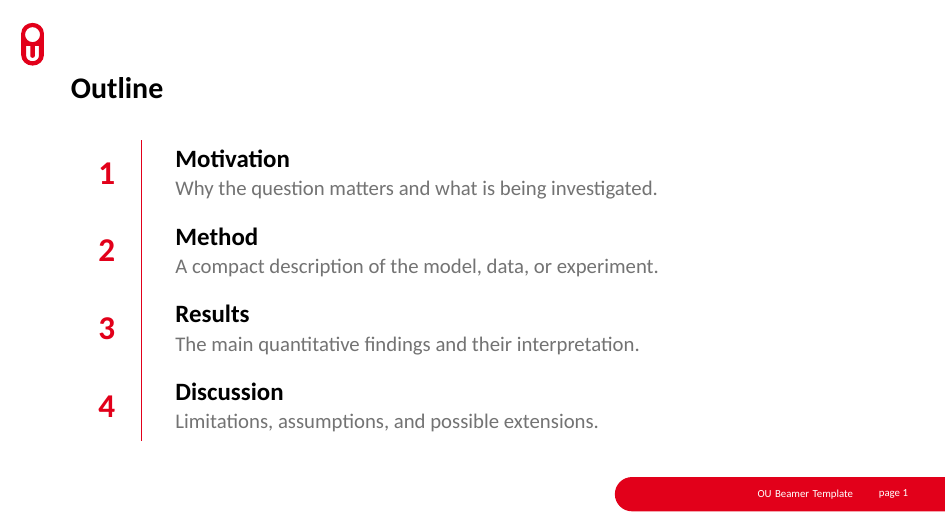
  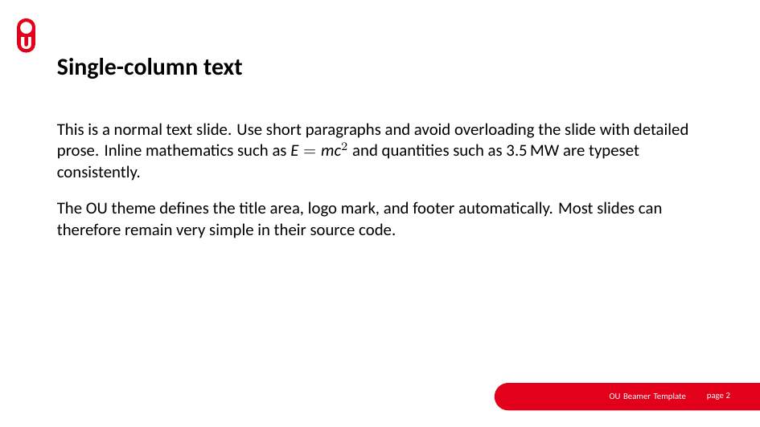
  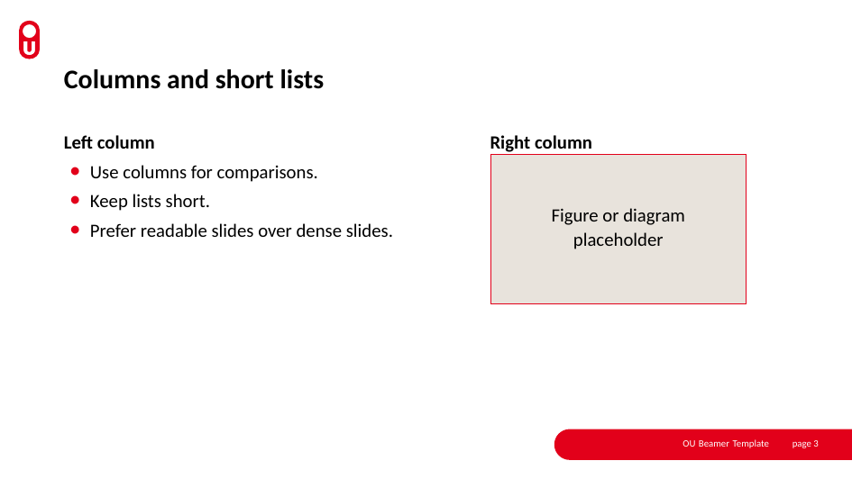
  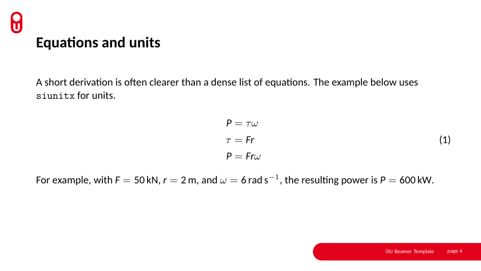
  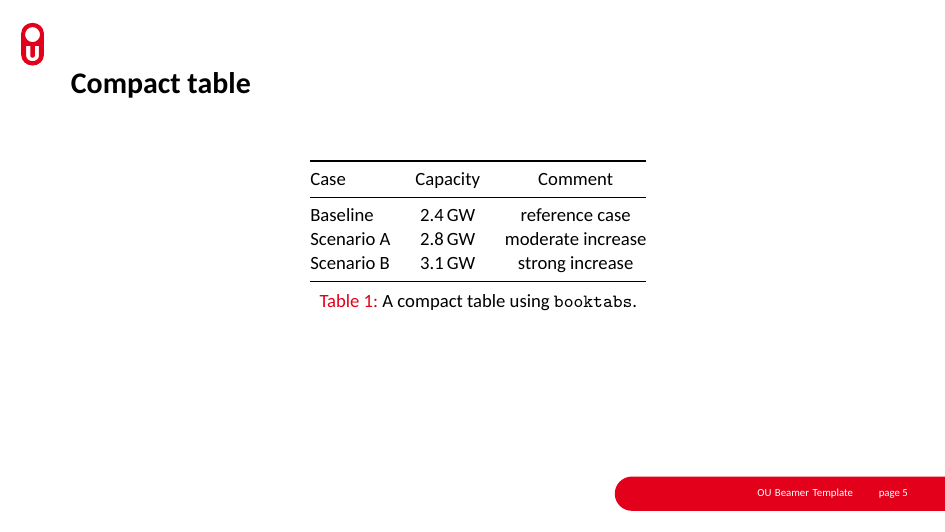
  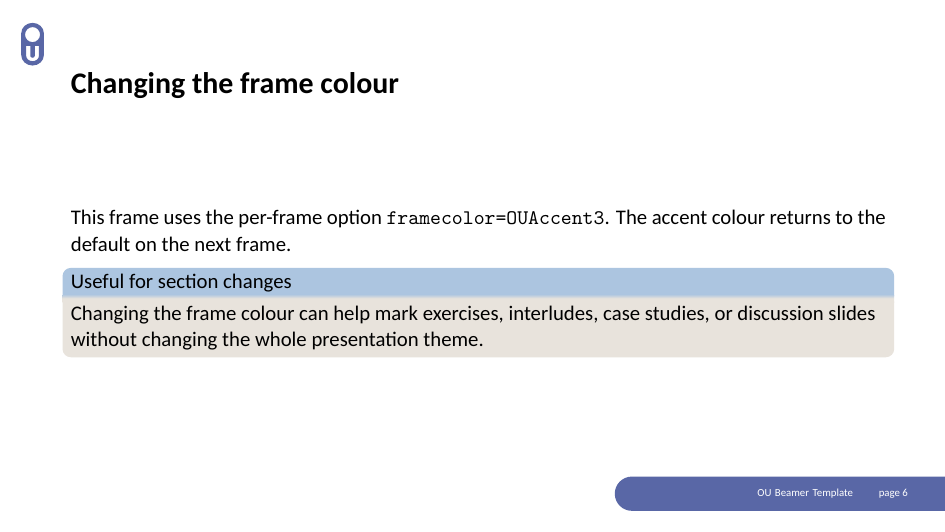
  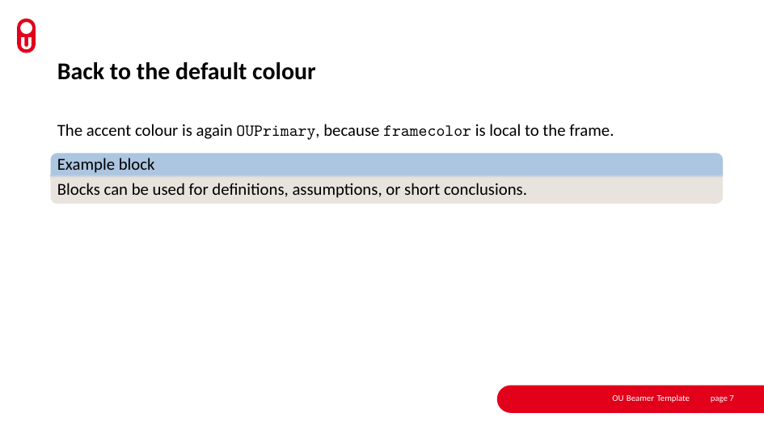
  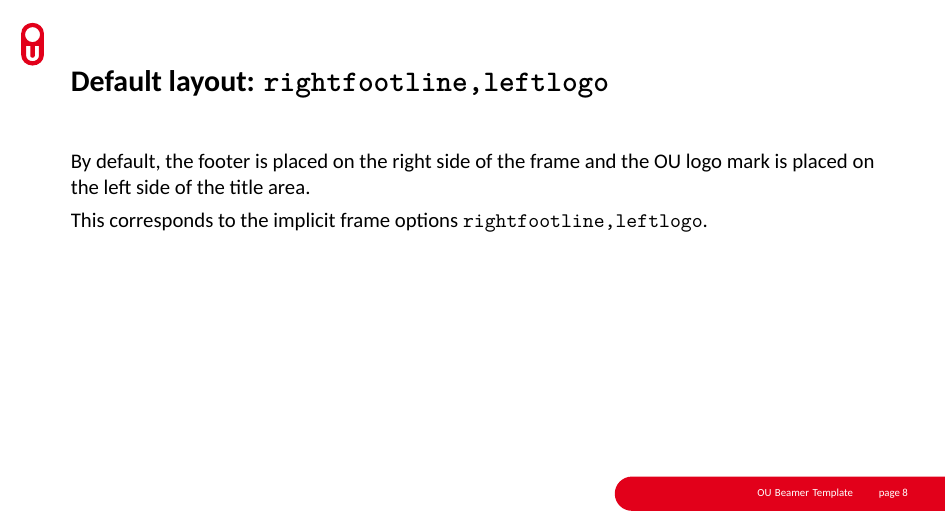
  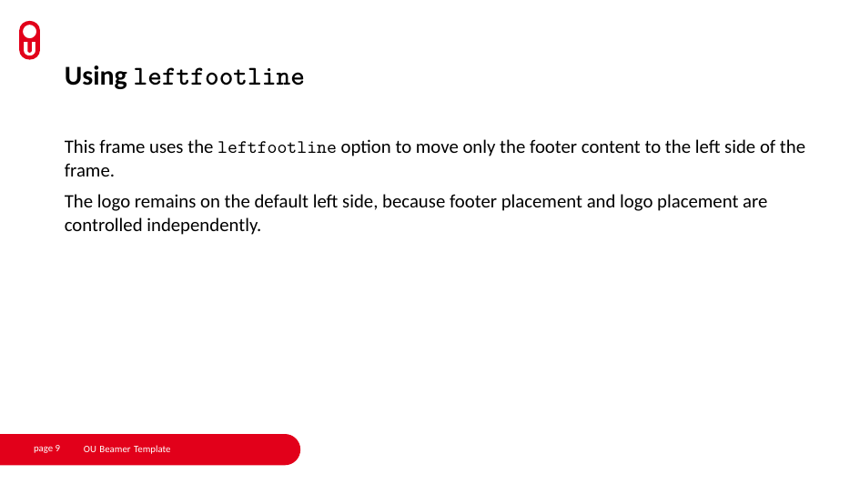
  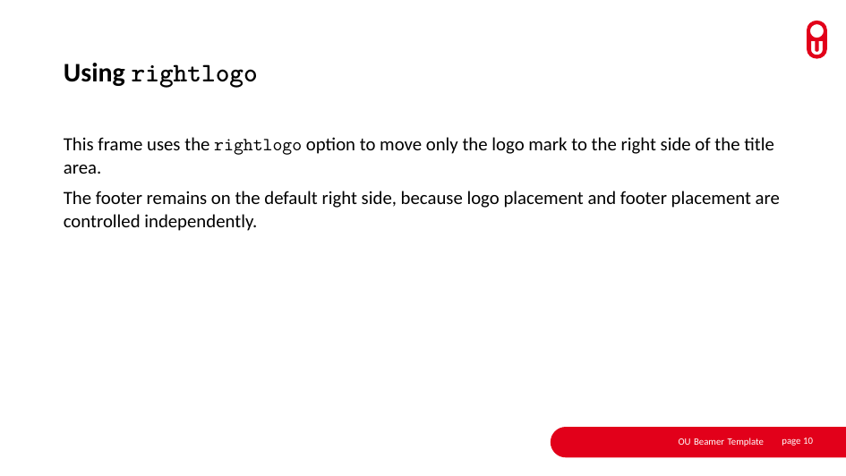
  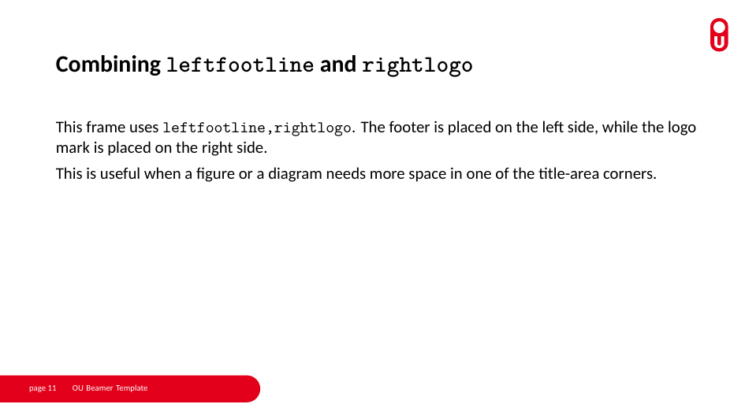
  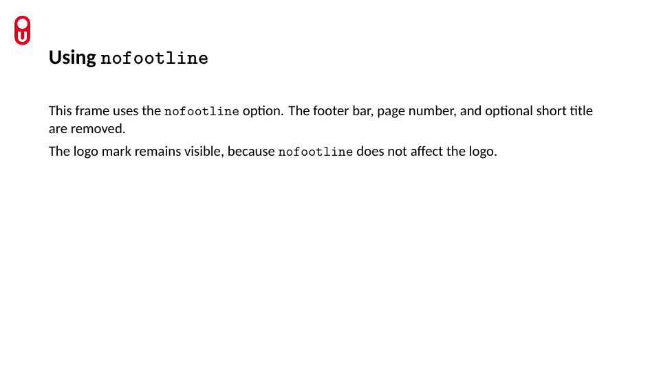
  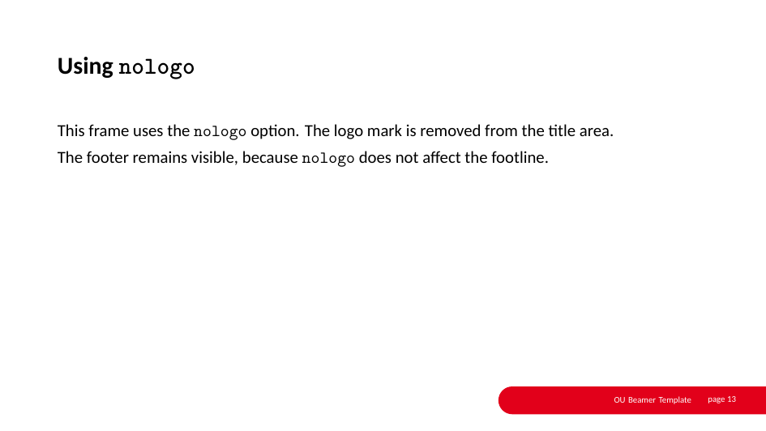
  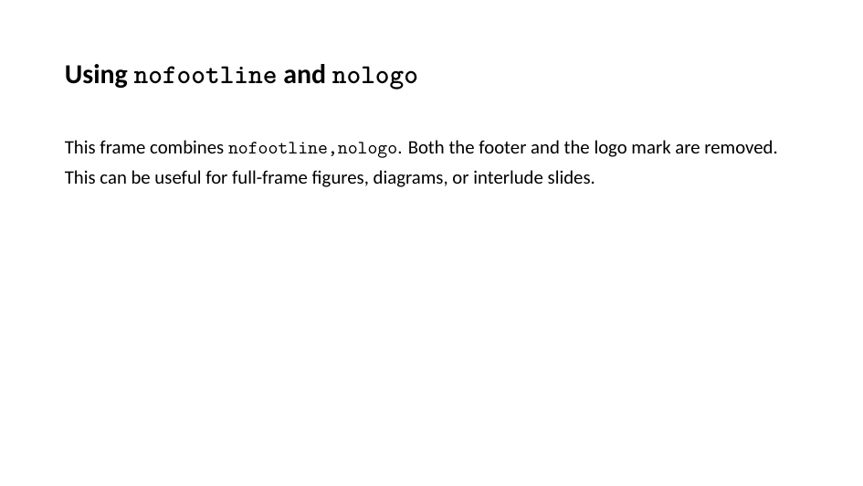
  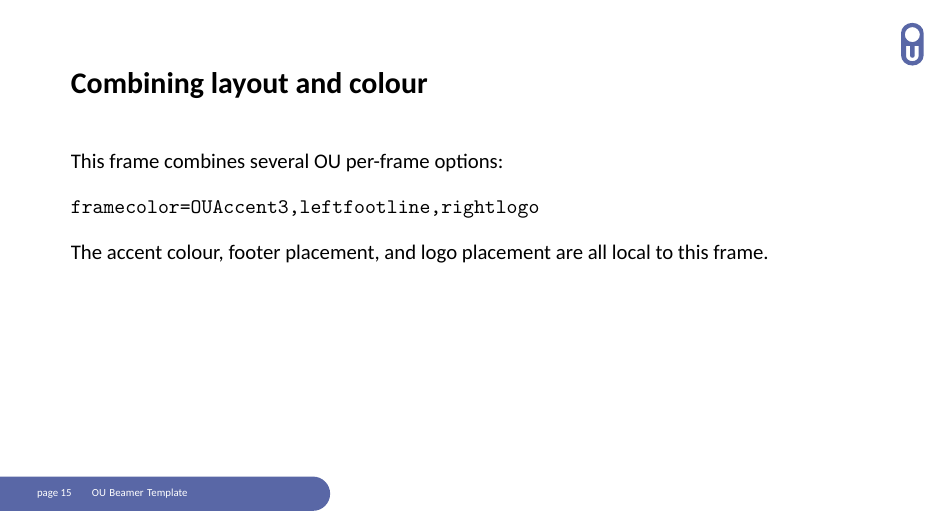
  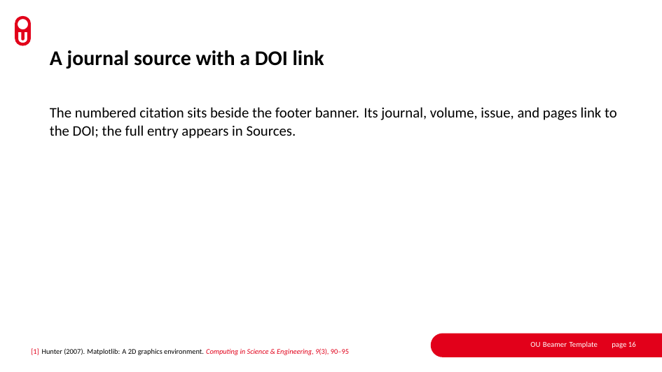
  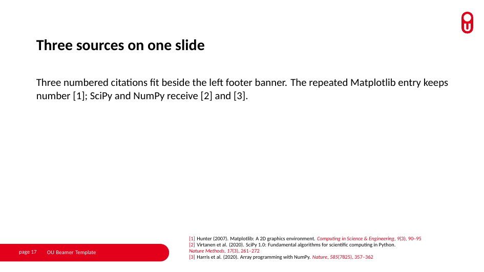
  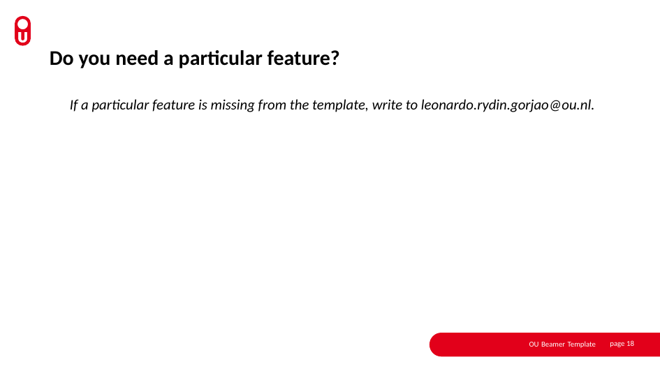
  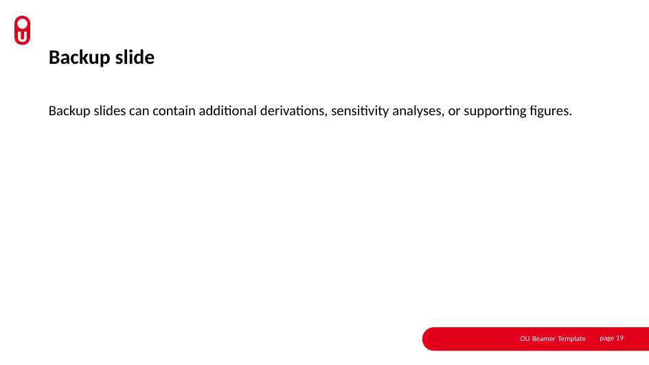
  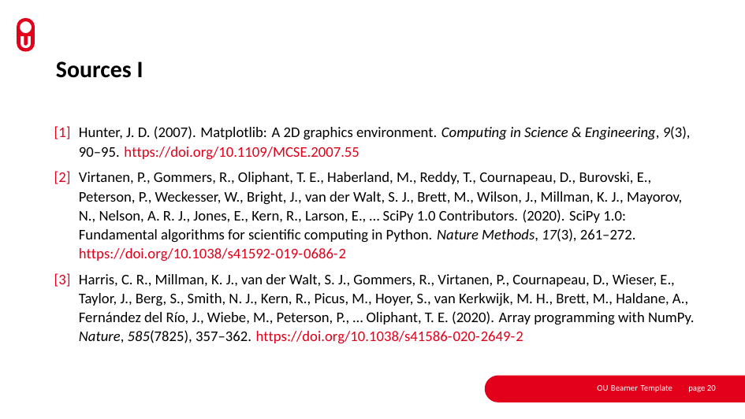
</picture>

## Versioning

- `v0.0.1`: first version of the OU Beamer template, including the base OU theme setup, outline environment, and per-frame `framecolor` option.
- `v0.0.2`: added footer title support through the `footertitle` theme option and the `\title[Short footer title]{...}` mechanism.
- `v0.0.3`: added the `leftfootline` and `nofootline` per-frame layout options.
- `v0.0.4`: separates footline and logo placement: `leftfootline`, `rightfootline`, `nofootline`, `leftlogo`, `rightlogo`, and `nologo`.
- `v0.1.0`: `OUaddtitlelogo` and `OUaddframelogo` added. Overall functional.
- `v0.1.1`: added per-frame `\source` credits and an optional `\printsources` bibliography, including matching bracketed numbers, short credits, duplicate removal, and Dutch heading support.
